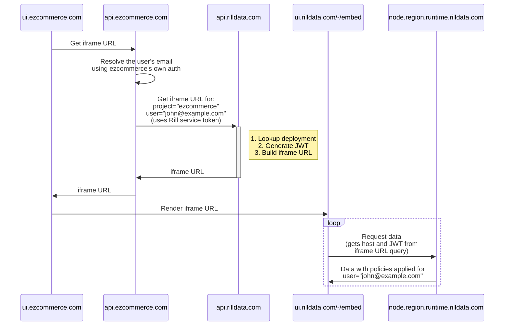

import Tabs from '@theme/Tabs';
import TabItem from '@theme/TabItem';

## Introduction

Rill Cloud provides the ability to embed dashboards as components in your own application using iframes, with a few different options:
- Embedding individual dashboards as standalone iframes
- Embedding individual dashboards with the ability to navigate to other dashboards (that exist in the _same_ project)
- Embedding the dashboard list page present in a Rill project (with the ability to select and navigate between dashboards)

When embedding Rill, you need to generate a service token for your backend to request an authenticated iframe URL via the Rill API. Afterward, the iframe URL can be passed to your frontend application for rendering. Here's a high-level diagram of what this flow looks like:



## Create a service token
Use the Rill CLI to create a service token for your current organization using the following command:
```bash
# Create with organization role
rill service create <service_name> --org-role admin

# Or create with project-specific role
rill service create <service_name> --project <project_name> --project-role admin
```

:::info
For comprehensive documentation on service tokens, including roles, custom attributes, and management, see [Service Tokens](/guide/administration/access-tokens/service-tokens). Also see the [CLI reference](/reference/cli/service) for command details.
:::

:::note Why is the admin role required?
Service tokens used for iframe embedding require the `admin` role to access the deployment management APIs that generate iframe URLs. Using the `viewer` role will result in a 403 permission error.
:::

:::caution
Service tokens can have broad permissions and should be handled confidentially. Therefore, the service token itself should **not** be integrated directly in frontend or other user-facing code that can be exposed publicly.
:::

## Backend: Build an iframe URL
You should implement an API on your backend that uses the service token to retrieve and return an iframe URL from Rill's API (which is hosted on `api.rilldata.com`).

There are multiple reasons why the iframe URL <u>must</u> be constructed on your backend:
- To avoid leaking your master Rill service token in the browser
- To allow you to use your own authentication and authorization logic to restrict access to the dashboard
- To optionally use your backend's context about the authenticated user to include user attributes in the iframe URL for enforcement of row-level security policies

Here are examples of how to get an iframe URL using different languages:

<Tabs>
  <TabItem value="curl" label="Curl" default>

```bash
curl -X POST --location 'https://api.rilldata.com/v1/orgs/<org-name>/projects/<project-name>/iframe' \
--header 'Content-Type: application/json' \
--header 'Authorization: Bearer <rill-svc-token>' \
--data-raw '{
"type": "explore",
"resource": "<explore-name>",
"user_email": "<user-email>"
}'
```
  </TabItem>
  <TabItem value="js" label="JavaScript">
    JavaScript (Node.js) with Express.js

```js
const express = require('express');
const fetch = require('node-fetch');

const rillServiceToken = "<YOUR RILL SERVICE TOKEN>";
const rillOrg = "<YOUR RILL ORG NAME>";
const rillProject = "<YOUR RILL PROJECT NAME>";

const app = express();
app.use(express.json());
app.post('/api/rill/iframe', async (req, res) => {
  const dashboardName = req.body.resource;
  try {
    const response = await fetch(`https://api.rilldata.com/v1/orgs/${rillOrg}/projects/${rillProject}/iframe`, {
      method: 'POST',
      headers: {
        'Content-Type': 'application/json',
        Authorization: `Bearer ${rillServiceToken}`,
      },
      body: JSON.stringify({
        type: 'explore',
        resource: dashboardName,
        // Optionally include the end user's email address for security policies:
        // user_email: '<end-user-email>',
        // Optionally set theme and theme mode:
        // theme: 'my-custom-theme',
        // theme_mode: 'dark', // Options: 'light', 'dark', 'system'
      }),
    });
    const data = await response.json();
    if (response.ok) {
      res.json(data);
    } else {
      throw new Error(data.message);
    }
  } catch (error) {
    res.status(500).json({ error: error.message });
  }
});

const PORT = 3000;
app.listen(PORT, () => {
  console.log(`Server running on port ${PORT}`);
});
```

  </TabItem>
  <TabItem value="python" label="Python">
    Python with Flask

```python
from flask import Flask, request, jsonify
import requests

app = Flask(__name__)

@app.route('/api/rill/iframe', methods=['POST'])
def get_rill_iframe():
    dashboard_name = request.json.get('resource')
    try:
        response = requests.post(
            'https://api.rilldata.com/v1/orgs/<org-name>/projects/<project-name>/iframe',
            headers={
                'Content-Type': 'application/json',
                'Authorization': 'Bearer <rill-svc-token>',
            },
            json={
                'type': 'explore',
                'resource': dashboard_name,
                # Optionally include the end user's email address for security policies:
                # 'user_email': '<end-user-email>',
                # Optionally set theme and theme mode:
                # 'theme': 'my-custom-theme',
                # 'theme_mode': 'dark',  # Options: 'light', 'dark', 'system'
            }
        )
        response.raise_for_status()
        data = response.json()
        return jsonify(data)
    except requests.RequestException as e:
        return jsonify(error=str(e)), 500

if __name__ == '__main__':
    app.run(port=3000)

```
  </TabItem>
  <TabItem value="go" label="Go">
    Go with net/http

```go
package main

import (
	"bytes"
	"encoding/json"
	"fmt"
	"io/ioutil"
	"net/http"
)

func getRillIframe(w http.ResponseWriter, r *http.Request) {
	var reqBody map[string]string
	json.NewDecoder(r.Body).Decode(&reqBody)
	dashboardName := reqBody["resource"]

	requestBody, err := json.Marshal(map[string]string{
		"type": "explore",
		"resource": dashboardName,
    // Optionally include the end user's email address for security policies:
		// "user_email": "<end-user-email>",
	})

	if err != nil {
		http.Error(w, err.Error(), http.StatusInternalServerError)
		return
	}

	resp, err := http.Post("https://api.rilldata.com/v1/orgs/<org-name>/projects/<project-name>/iframe", "application/json", bytes.NewBuffer(requestBody))
	if err != nil {
		http.Error(w, err.Error(), http.StatusInternalServerError)
		return
	}
	defer resp.Body.Close()

	body, err := ioutil.ReadAll(resp.Body)
	if err != nil {
		http.Error(w, err.Error(), http.StatusInternalServerError)
		return
	}

	var respBody map[string]any
	err = json.Unmarshal(body, &respBody)
  if err != nil {
		http.Error(w, err.Error(), http.StatusInternalServerError)
		return
	}

	w.Header().Set("Content-Type", "application/json")
	err = json.NewEncoder(w).Encode(respBody)
  if err != nil {
		http.Error(w, err.Error(), http.StatusInternalServerError)
		return
	}
}

func main() {
	http.HandleFunc("api/rill/iframe", getRillIframe)
	fmt.Println("Server started at port 3000")
	http.ListenAndServe(":3000", nil)
}
```
  </TabItem>

  <TabItem value="java" label="Java">
    Java With Spring Boot

```java
import org.springframework.web.bind.annotation.PostMapping;
import org.springframework.web.bind.annotation.RequestBody;
import org.springframework.web.bind.annotation.RestController;
import org.springframework.web.client.RestTemplate;
import org.springframework.http.ResponseEntity;
import org.springframework.http.HttpEntity;
import org.springframework.http.HttpHeaders;
import java.util.HashMap;
import java.util.Map;

@RestController
public class DashboardController {

    @PostMapping("/api/rill/iframe")
    public ResponseEntity<?> getRillIframe(@RequestBody Map<String, Object> payload) {
        String dashboardName = (String) payload.get("resource");
        HttpHeaders headers = new HttpHeaders();
        headers.set("Content-Type", "application/json");
        headers.set("Authorization", "Bearer <rill-svc-token>");

        Map<String, Object> request = new HashMap<>();
        request.put("type", "explore");
        request.put("resource", dashboardName);
        // Optionally include the end user's email address for security policies:
        // request.put("user_email", "<end-user-email>");

        HttpEntity<Map<String, Object>> entity = new HttpEntity<>(request, headers);
        RestTemplate restTemplate = new RestTemplate();
        ResponseEntity<Map> response = restTemplate.postForEntity(
                "https://api.rilldata.com/v1/orgs/<org-name>/projects/<project-name>/iframe",
                entity,
                Map.class
        );

        return ResponseEntity.ok(response.getBody());
    }
}
```
  </TabItem>

</Tabs>


The API accepts the following parameters:

| Parameter        | Description                                                                                                                                                                     | Required                                                          |
| ---------------- | ------------------------------------------------------------------------------------------------------------------------------------------------------------------------------- | ----------------------------------------------------------------- |
| resource         | The name of the dashboard to embed                                                                                                                                              | No (if not specified, `navigation` should be set to `true`)       |
| type             | The type of the dashboard identified by `resource` (options: `explore`, `canvas`)                                                                                               | No (defaults to `explore`)                                        |
| navigation       | Boolean whether to enable navigation and allow users to navigate to other dashboards (`false` only shows the dashboard in `resource`; `true` allows navigation) | No (defaults to `false`)                                          |
| hide_navigation_bar | Boolean whether to hide the navigation bar (the home link and dashboard breadcrumbs) while keeping navigation enabled. Only meaningful when `navigation` is `true`; the bar is always hidden when `navigation` is `false`. In-dashboard navigation, such as the drill-through from a Canvas component to an Explore dashboard, remains available. | No (defaults to `false`)                                          |
| theme            | If [themes](/developers/build/dashboards/customization#changing-themes--colors) are being used, the specific theme to pass to the embedded dashboard                            | No (set to the name of the theme)                                 |
| theme_mode       | The theme mode to use for the embedded dashboard. Valid values: `light`, `dark`, `system`. When set to `system`, the dashboard will follow the user's system preference.        | No (defaults to `light`)                                          |
| user_email       | Email of the end user accessing the embed. Used to populate attributes for use in security policies.                                                                            | No (only one of `user_email` or `attributes` should be passed in) |
| attributes       | Raw attributes about the end user. Used to populate attributes for use in security policies.                                                                                    | No (only one of `user_email` or `attributes` should be passed in) |
| external_user_id | A stable identifier for an external end user, at most 2048 bytes. Enables per-user state.                                                                                       | No                                                                |
| ttl_seconds      | The time to live for the iframe URL                                                                                                                                             | No (Default: 86400)                                               |
| open             | The `rill_open` query parameter from a report email link. Opens the dashboard in the state captured by the report. See [Open links in report emails](#open-links-in-report-emails). | No (requires `external_user_id`; cannot be combined with `resource`) |


The response of the POST request will then contain an `iframeSrc` value that can be used to embed the dashboard or set of dashboards in your application. It will also contain a `ttlSeconds` value, which indicates how long the iframe URL will be valid for. _After the TTL has elapsed_, the iframe URL needs to be refreshed as the underlying access token being used will no longer be valid (for security purposes). Here's an example response:

```json
{
  "iframeSrc": "https://ui.rilldata.com/-/embed?access_token=<token>&instance_id=<id>&type=<dashboard type>&resource=<dashboard name>&runtime_host=<runtime host>",
  "runtimeHost": "<runtime_host>",
  "instanceId": "<id>",
  "accessToken": "<token>",
  "ttlSeconds": 86400
}
```

## User identity in embeds

The `user_email`, `attributes` and `external_user_id` parameters serve two purposes in the embeds:
- **User attributes for security policies:** `user_email` and `attributes` determine which attributes (such as `email`, `domain`, and `admin`) are available for use in [security policies](/developers/build/metrics-view/security).
- **Per-user state:** `external_user_id` establishes a stable user identity that isolates per-user features such as AI chat history. Without a user identity, these features are not available.

Only one of `user_email` or `attributes` can be provided for a given iframe. The `external_user_id` parameter can optionally be combined with either of them. Here is how each parameter works:
- `user_email`: Looks up the user in Rill Cloud by email and populates their standard attributes. If no matching user is found, it generates limited attributes with only the fields `email`, `domain` (the part of the email after `@`) and `admin` (set to `false`). The derived `domain` is commonly used in security policies (e.g. `app_site_domain = '{{ .user.domain }}'`). Does not enable per-user state on its own; combine with `external_user_id` to enable per-user state.
- `attributes`: Passes the provided attributes through directly. Make sure to include all attributes referenced in your security policies (e.g. `email`, `domain`, `admin`, or custom attributes like `tenant_id`). Does not enable per-user state on its own; combine with `external_user_id` to enable per-user state.
- `external_user_id`: An opaque, stable identifier for the end user. Setting it enables per-user state such as AI chat history, [scheduled reports](#scheduled-reports-in-embeds) and [bookmarks](#bookmarks-in-embeds). The ID can be at most 2048 bytes long in UTF-8, where each non-ASCII character takes more than one byte. Requests with a longer ID fail with an HTTP 400 error.

:::warning Use one `external_user_id` per security context
Rill stores per-user state, such as AI chat history and the identity that scheduled reports run as, by `external_user_id`. So the ID must identify one security context, not just one person. If the same person can open your app in several tenants, and the `user_email` or `attributes` you pass vary by tenant, include the tenant in the ID, for example `<tenant id>:<user id>`. Use a separator that can't appear in either part; otherwise IDs collide (user `a_b` in tenant `c` and user `a` in tenant `b_c` both become `a_b_c`).

If you change the format of your IDs, existing users lose their AI chat history and the scheduled reports they created stop running.
:::

The same attributes decide what an embedded canvas shows. Canvas rows, tabs and components can have [`if` conditions](/developers/build/dashboards/canvas#show-content-to-some-viewers-only) on them, such as `'{{ eq .user.plan "premium" }}'` to show premium content only to tenants on that plan. Every embed also carries the attribute `embed: true`, so a condition like `'{{ not .user.embed }}'` keeps content out of embedded dashboards.

## Scheduled reports in embeds

Embed users can schedule email reports of the explore dashboards they can see. Reports are disabled in embeds by default; enable them with the `reports` [feature flag](/reference/project-files/rill-yaml#features), for example `reports: true` to enable them everywhere.

Reports created from an embed work as follows:
- **They require `external_user_id`.** Each report is owned by the external user who created it, so iframes without an `external_user_id` don't show the option to create reports.
- **They run as the owner's latest identity.** Every time you request an iframe for an external user, Rill saves the `user_email` or `attributes` you passed. All of the user's reports run with the saved identity; for example, if you change a user's `attributes`, their reports use the new attributes from their next run onwards. If the iframe a report was created from was limited to one dashboard, the report is limited to that dashboard too. Otherwise, if the saved `user_email` belongs to a project member who can only access some dashboards, the report has the same restriction.
- **They are sent by email with the export attached.** Recipients can be any email address; if you pass `user_email`, it is the default recipient. Every recipient receives the data the owner can see. The emails don't link back to Rill, so the export is always attached (up to 10 MB). Every recipient also gets a link to unsubscribe, and the owner can get a link to open the report in your application (see [Open links in report emails](#open-links-in-report-emails)); in that case, the owner always gets the report and can't unsubscribe from it, so they stop it by deleting the report.
- **They pause after 90 days of inactivity.** If you don't request an iframe for the owner for 90 days, their reports stop running. They resume the next time you request an iframe for the owner. To stop a user's reports right away, for example when you remove the user from your app, delete the reports in Rill Cloud.
- **Only the owner can manage them in the embed.** Embed users whose attributes include `admin: true` can also see other users' reports, but can't edit them. Project admins can manage all reports in Rill Cloud, where reports created from an embed are shown with the owner's `external_user_id`.

## Personal canvases in embeds

Embed users can create, edit and delete their own canvas dashboards, called personal canvases. Personal canvases are disabled by default; enable them with the `personal_canvases` [feature flag](/reference/project-files/rill-yaml#features). Feature flags can be templated with user attributes, so you can enable personal canvases for embed users only:

```yaml
features:
  personal_canvases: '{{ .user.embed }}'
```

Personal canvases created from an embed work as follows:
- **They require `external_user_id` and `navigation: true`.** Each personal canvas is owned by the external user who created it, so iframes without an `external_user_id`, or limited to a single dashboard, don't show personal canvases.
- **They are listed in the embed.** The navigation bar has a menu to open, create and delete personal canvases, and the project home page lists them above the other dashboards.
- **Only the owner can see them.** Personal canvases created from an embed can't be shared, so other embed users and project members can't see them. Rill project admins can also access them.
- **They respect security policies.** Like any dashboard, a personal canvas only shows the data the viewer can access through [security policies](/developers/build/metrics-view/security).

## Bookmarks in embeds

Embed users can save the current state of a dashboard, such as its filters and time range, as a bookmark, and reopen it later. Bookmarks in embeds are disabled by default; enable them with the `embedded_bookmarks` [feature flag](/reference/project-files/rill-yaml#features). Feature flags can be templated with user attributes, so you can enable bookmarks for embed users only:

```yaml
features:
  embedded_bookmarks: '{{ .user.embed }}'
```

Bookmarks created from an embed work as follows:
- **They require `external_user_id`.** Each bookmark is owned by the external user who created it, so iframes without an `external_user_id` don't show bookmarks. Bookmarks are stored by `external_user_id`, so follow the [guidance on choosing it](#user-identity-in-embeds): a user who has several IDs has separate bookmarks for each, and users who share an ID share their bookmarks.
- **They are managed from the bookmarks menu.** The bookmarks menu is in the navigation bar when it is visible. When the bar is hidden, the menu appears in the top-right corner of the active dashboard.
- **Only the owner can see them.** Bookmarks created from an embed can't be shared, so other embed users and project members can't see them. Likewise, embed users don't see the shared and home bookmarks that project admins create in Rill Cloud.
- **They follow the iframe's dashboards.** If the iframe is limited to one dashboard with `resource`, the embed user can only create and see bookmarks for that dashboard.
- **They respect security policies.** A bookmark only stores the dashboard state; opening it shows the data the viewer can access through [security policies](/developers/build/metrics-view/security).
- **They are limited to 100 per external user** in a project.

## Embedding the project vs embedding an individual dashboard

One of the most common differences between how developers may wish to iframe Rill is whether they wish to embed at the project level or individual dashboard level. This behavior can be controlled through the combination of the `resource` and `navigation` properties!

If you wish to embed a single dashboard **only**, your payload might look like:
```json
{
  "type": "explore",
  "resource": "dashboardName"
}
```

:::note Use security policies to control access
`resource` and `navigation` decide which dashboards an iframe shows; they are not meant for access control. To decide which data a user can access, pass `user_email` or `attributes` and enforce them with [security policies](/developers/build/metrics-view/security). This matters most when your app links to several dashboards through separate single-dashboard iframes: the user's access should be the same in all of them, since they share per-user state, such as scheduled reports, through the same [`external_user_id`](#user-identity-in-embeds).
:::

If you wish to still embed a dashboard _but allow navigation between dashboards_, then your payload should include both parameters:
```json
{
  "type": "explore",
  "resource": "dashboardName",
  "navigation": true
}
```

If you wish to allow navigation _but hide the navigation bar_ — for example to embed a Canvas dashboard whose components can drill through to an Explore dashboard, without showing Rill's own breadcrumbs — then add `hide_navigation_bar`:
```json
{
  "type": "canvas",
  "resource": "dashboardName",
  "navigation": true,
  "hide_navigation_bar": true
}
```

Note that in this mode there is no in-iframe affordance for returning from a dashboard the user drilled into. Your application should listen for the [`navigation` notification](/developers/embed/postmessage) — still emitted when the navigation bar is hidden — and provide its own way back.

Finally, _if you wish to embed the project list view of dashboards instead (what you see when you first open a project in Rill Cloud)_, then you can simply omit the `resource` and appropriately set `navigation` in your payload:
```json
{
  "navigation": true
}
```

## Testing the dashboard

While it is possible to create the iframeSrc URL via the CLI or code to _test_ your embedded dashboard, it might be easier to start off using [Rill Developer's mock users](/developers/build/metrics-view/security#advanced-example-custom-attributes-embed-dashboards), especially if you have multiple attribute views that you want to test before deploying to Rill Cloud. You can pass specific custom_attributes as you would during iframe URL generation to view the pre-filtered explore dashboard.

```yaml
- email: embed@rilldata.com
  name: embed
  custom_variable_1: Value_1
  custom_variable_2: Value_2
```


## Frontend: Embed the dashboard
Your frontend should request an iframe URL from your backend API (which you set up in the previous step) and use the `iframeSrc` value of the response to render an HTML `<iframe>` element:
```html
<iframe title="rill-dashboard" src="<iframeSrc>" width="100%" height="100%" allow="clipboard-write" />
```

The `allow="clipboard-write"` attribute lets the dashboard copy values to the clipboard, for example when users Shift+Click a cell. Chrome and Edge block the Clipboard API in cross-origin iframes that are not granted this permission.

Once the dashboard is embedded, the parent page can also read and write its UI state (selected resource, filters, time range, view type, and so on) using a `postMessage`-based API exposed by the iframe. See the [postMessage API](/developers/embed/postmessage) reference for details.

## Open links in report emails

Emails from [scheduled reports created in an embed](#scheduled-reports-in-embeds) don't include edit or download links, since their recipients may not have access to Rill Cloud.

Since the embedded dashboard lives in your application, Rill can't link to it on its own.
To include an **Open** link in these emails, give Rill the URL of a page in your application that runs your embed integration, such as `https://app.ezcommerce.com/analytics/open`.
When the user clicks the link, they land on that page, which renders the embedded dashboard in the state captured by the report.

Only the user who created the report gets the open link, since the link opens the dashboard with their access.
Other recipients get the report without it.
Rill sends the link to the creator's email address, which comes from:
- the `user_email` of the iframe the report was created or last edited in, if you passed one;
- otherwise, the email the creator entered when creating the report. If they left it empty, no recipient gets an open link.

The creator's email always gets the report, and it has no unsubscribe link, so the creator stops the report by deleting it.

If no open URL is configured, the emails have no open link. Reports still attach the exported file.

### Configure the open URL

Set the open URL for the project with the `embeds.open_url` property in `rill.yaml`:

```yaml
embeds:
  open_url: https://app.ezcommerce.com/analytics/open
```

The open URL must be an absolute `http` or `https` URL. It can include its own query parameters; Rill keeps the URL as-is and appends a `rill_open` parameter to the end of its query string, for example:

```
https://app.ezcommerce.com/analytics/open?tenant=acme&rill_open=<value>
```

The `rill_open` parameter is always added to the query string, before any `#` fragment.
If your application routes with the fragment, such as `https://app.ezcommerce.com/#/analytics/open`, the link is `https://app.ezcommerce.com/?rill_open=<value>#/analytics/open`, so read the parameter from `window.location.search` rather than from your router.

### Handle the open page

On the open page:
1. Authenticate the user with your own auth, as you do for other embedded dashboards.
2. Read the `rill_open` query parameter from the URL, and pass it to your backend.
3. On your backend, request an iframe URL with `open` set to the `rill_open` value. Pass the `external_user_id` of the logged-in user, not the ID of the report's creator. The report can only be opened by its creator, so the request fails for other users. Do not pass `resource`, since Rill resolves the dashboard from `open`.
4. Render the returned `iframeSrc` in an iframe [as usual](#frontend-embed-the-dashboard).

```json
{
  "external_user_id": "acme:john",
  "user_email": "john@example.com",
  "open": "<rill_open value>"
}
```

You can combine `open` with other parameters such as `navigation`, `theme`, and `theme_mode`. When `navigation` is `false`, the iframe has the same access as the report: if the report was created from an iframe limited to a dashboard, the iframe is limited to that dashboard as well.

:::note
Treat the `rill_open` value as opaque and forward it to Rill unchanged. Its format may change over time.
:::

## Appendix

### React Example

Depending on how your app is written and the language being used, you can then use the resulting iframe URL to embed and display Rill dashboards accordingly. Below is a basic example of how to fetch and render a dashboard in **React**:

```jsx
import React, { useEffect, useState } from 'react';

export default function RillDashboard() {
  const [isLoading, setLoading] = useState(true);
  const [iframeSrc, setIframeSrc] = useState('');
  const [error, setError] = useState('');

  useEffect(() => {
    fetch(`<YOUR BACKEND HOST>/api/rill/iframe`, {
      method: 'POST',
      headers: {
        'Content-Type': 'application/json',
      },
      body: JSON.stringify({ resource: '<your-dashboard-name>' }),
    })
    .then((response) => response.json())
    .then(({ iframeSrc, error }) => {
      if (error !== undefined) {
        setError(error);
      } else {
        setIframeSrc(iframeSrc);
      }
      setLoading(false);
    })
    .catch((err) => {
      setError(err.message);
      setLoading(false);
    });
  }, []);

  if (isLoading) return <p>Loading...</p>;
  if (error) return <p>Failed with error: {error}</p>;

  return (
    <iframe title="rill-dashboard"
      src={iframeSrc}
      width="100%"
      height="1000"
      allow="clipboard-write"
    />
  );
};
```

### Next.js Example

You can find a different end-to-end example of embedding a Rill dashboard in a **Next.js** project in [`rilldata/rill-examples/embedding`](https://github.com/rilldata/rill-examples/tree/main/embedding).
